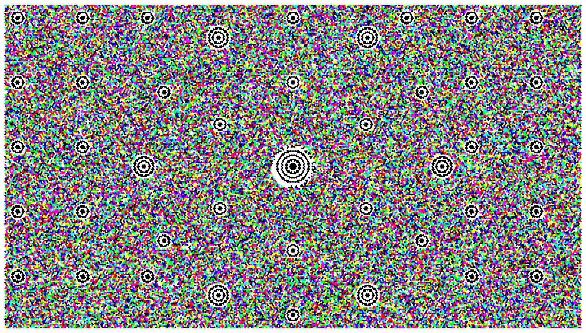

# wabe.

**A 2D barcode that carries whole files, on paper and on screens.** wabe. is a round (or rectangular) code on a hexagonal grid, an alternative to QR codes when you want more than a link inside.

   

Prototype v0.1: measured in simulation, no real print-and-photo test yet (see [Open](#open)).

A round (or rectangular) black-and-white or colour code on a hexagonal grid. Whole files (PDF, HTML, ...) inside the code, no server needed. Printable on any laser, inkjet or label printer, readable with a phone camera or scanner. On screens it also works as a stream: a file plays as a loop of codes and a phone camera picks it up, in the browser, even offline.



*A 100 KB image (`docs/bye-bye.jpg`) as a loop of 10 colour codes, then the decoded result. The GIF is a real stream: decoding its own frames returns `bye-bye.jpg` byte for byte, from any 5 to 7 of them. Shown 1:1 on a screen it is meant to be read with the camera page.*

*wabe* is German for honeycomb. A few module names and JSON keys are German for historical reasons: `dicht` = container/density, `strom` = stream, `kamera` = camera, `lokal` = local (decoder in the browser); API fields such as `fehler` (error), `bloecke` (blocks), `fertig` (done).

## Files

| File | Purpose |
|---|---|
| `wabe.py` | Encoder, decoder, CLI |
| `dicht.py` | File container, Reed-Solomon plan, scrambler, interleaving (shared) |
| `strom.py` | Stream mode: fountain-code encoder/decoder, HTML player and GIF for the screen |
| `kamera.py` | Phone photo and scanner simulation (perspective, lens, paper waves, blur, light, noise, JPEG) |
| `demo.py` | Creates the demo files in `demo/` |
| `server.py` | Camera test server (stdlib HTTP) with the stream endpoint and diagnostics |
| `web/` | The camera page, an installable PWA, with the in-browser decoder (Pyodide) |
| `qrstrom.py` | The same stream logic with QR frames, for an A/B comparison |
| `PORT.md`, `fixtures/` | Porting kit for a native/WASM decoder |

`pip install numpy opencv-python reedsolo brotli reportlab pillow`

```
python wabe.py capacity
python wabe.py encode file.pdf -o code             # -> code.png
python wabe.py encode file.pdf --shape hexagon     # hexagon outline
python wabe.py encode file.pdf --levels 4          # 4 grey levels, double capacity (see below)
python wabe.py decode photo.jpg
```

(The colour flag is `--color`, the old German `--farbe` still works.)

## Design

* Cells on a hexagonal grid, distance between cell centres = 1 pitch. 15 % more cells than a square grid at the same minimum spacing (i.e. the same camera resolution).
* Outline: circle or hexagon, radius R in pitches. Any other convex outline would work with the same machinery.
* Bullseye in the middle: 4 black rings, rotation invariant, found in any orientation.
* 6 principal markers (2 rings) at the edge: perspective. Orientation comes from the format ring; the decoder tries the 6 rotations.
* Alignment markers (1 ring) on rings every 40 pitches, dense enough for lens distortion and wavy paper. Markers are placed at the ink centroid of their cells, not at the nominal position (grid quantisation of up to 0.5 pitch).
* Format ring around the bullseye: version, shape, radius, EC level, number of levels. 16 bit + CRC-8 + RS(6,3), three times.
* Data: Reed-Solomon over GF(256), selectable redundancy 15/25/35/50 %, interleaved blocks, xorshift scrambler, Brotli compression, header with file type, name, chunk i/n, CRC32.
* Optionally 4 grey levels per cell = 2 bit (for screens and laser printing; thermal printers stay at 2 levels).

## Decoder

1. Illumination-normalised binary image, contour tree: ring discs by nesting depth and size.
2. Homography from the centre and the principal markers, radius estimated from the marker spacing.
3. Alignment markers matched ring by ring, thin-plate spline on the residual after each ring.
4. Read the format ring (6 rotations, threshold from the bullseye rings).
5. Data-driven fine alignment: per 16×16-pitch tile, the sub-pitch shift with the most bimodal sampling.
6. Local black/white levels from the data itself, equalisation of the cross-talk from the 6 neighbours, quantisation.
7. Plausibility check on the fixed cells, then descramble, de-interleave, Reed-Solomon, header, CRC.

## Capacity (25 % redundancy, circle)

| Radius | Cells | Diameter (0.25 mm) | Bytes B/W | Bytes 4 levels |
|---|---|---|---|---|
| 32 | 3,697 | 16 mm | 164 | 328 |
| 64 | 14,845 | 32 mm | 1,205 | 2,417 |
| 100 | 36,295 | 50 mm | 3,124 | 6,244 |
| 160 | 92,845 | 80 mm | 8,081 | 16,140 |
| 256 | 237,727 | 128 mm | 21,090 | 42,107 |
| 320 | 371,485 | 160 mm | 32,814 | 65,629 |
| 400 | 580,381 | 200 mm | 51,365 | 102,794 |
| 500 | 906,901 | 250 mm | 80,335 | 160,670 |

QR version 40: 2,953 bytes at 177×177 modules. Honestly counted, density per cell at equal redundancy is similar to QR. The gain comes from the 15 % hexagonal grid, from size (QR ends at 177 modules), from 2.6 to 3 camera pixels per pitch instead of 3 to 4, from compression, and from the 4-level mode.

## Measured (simulation)

* Resolution limit: 2.6 px/pitch reliable, 2.3 partly, below that nothing. 4 levels: reliable from 4 px/pitch.
* A4 code (R=320, 32.8 KB) with a 12 MP phone photo (3.6 px/pitch): 20/20 with random perspective up to 14 %, any rotation, blur up to 1.1 px, JPEG 55 to 90, lens k1 −0.1 to 0.12, paper waves up to 12 px. Median 15 corrected bytes out of 44,000.
* Small code (R=100, 3.1 KB) under the same conditions with realistic paper curvature: 38/40. The two failures had extreme pincushion distortion (k1 = −0.11).
* Lens k1 = 0.15 plus waves of 15 px on A4: readable with 999 corrections (the limit is 5,500).

## Screens

The A4 code is made for paper. On a laptop a PDF viewer shows the 640-cell diameter on about 1,000 screen pixels, i.e. 1.6 px per cell. The cells are gone before the camera even sees them (limit 2.6). For screens:

```
python wabe.py screen file.pdf --size 1920x1080      # -> blatt_01.png, blatt_02.png ...
```

Creates sheets with up to 2 circles each (R=100, 4 levels, 3.5 px per cell). Show the sheet 1:1 (image viewer at 100 %, no browser zoom), one photo per sheet; `decode` reads all circles in a photo. Simulation with pixel grid, moiré and glare: 15/15 codes at 1.5 to 2.5 camera pixels per screen pixel.

## Stream: a file from the screen to the phone by holding it up

The free dimension on a screen is time. `strom` splits the file into K blocks and shows a loop of frames; every frame is a random XOR combination of the blocks (random linear fountain over GF(2), seed in the frame). The phone needs neither the first frame nor every frame: any K to K+2 readable frames are enough, in any order. No sync, no back channel.

```
python wabe.py strom file.pdf -o strom          # -> strom.html (player, device pixels 1:1) and strom.gif
```

Default: R=128, 5.1 KB per frame, 4 fps. The 42 KB manual is 7 blocks, i.e. 1.8 s of holding the phone up with lossless reading; in the simulation with a filmed screen, a random start and every third frame missed it took 7 to 8 photos. The decoder needs 0.4 s per frame (1,500 px photo) in Python, i.e. 2 to 3 frames per second, 10 to 15 KB/s. `server_beispiel.py` shows the FastAPI integration: the phone sends a downscaled JPEG every 300 to 500 ms, the server reports progress, and in the end returns the file.

The maths is in `strom.py` (StreamEncoder, StreamDecoder with incremental Gaussian elimination). The player shows its frames in a new random order each round, so the camera cannot fall into lockstep with a fixed frame sequence (with a fixed order and rhythm, the last block can take dozens of extra frames).

## Colour and rectangle (screens)

`--color`: three channels per cell, value = R<<2 | G<<1 | B with 1 = ink in the channel (0 white, 7 black). All fixed structures stay black/white and detection runs unchanged on the grey image; only the data cells are normalised, equalised and decided per channel. `--form rect`: 16:9 rectangle, R = half the height, alignment markers on a 40-pitch grid outside the inner circle; the decoder determines the rotation there geometrically (grid markers only have 2-fold symmetry), the format ring decides the rest.

A screen rectangle with R=128 (1614×917 px at 3.5 px per cell) in colour holds **35 KB per frame**, 7× the B/W circle and 6× two QR v40 side by side. Simulation (pixel grid, moiré, glare, colour cast, perspective, any rotation): 12/12, median 21 corrected bytes. The 160 KB catalogue was complete after 4 filmed frames. Decoding takes 1.2 to 1.5 s per frame in Python (134,000 cells, 3 channels).

```
python wabe.py strom file.pdf --form rect --color -o strom     # full screen, colour
python wabe.py encode file.pdf --shape rect --color            # a single screen image (up to 35 KB)
```

In practice: a phone exports JPEG with 4:2:0 chroma subsampling (half colour resolution), and the bits sit exactly in the colour. So make colour cells at least 4.5 screen pixels wide (`strom --color` uses that as the default, R=100, 21.7 KB per frame): in the simulation 0 corrections instead of up to 734 at 3.5 px. Colour is meant for screens only; on paper, printer inks and chroma subsampling apply, so B/W stays.

## Comparison with QR in live mode

Same screen area (917 px), same fountain code, same screen simulation, 42 KB manual:

| | Bytes per frame | Frames until done | Decode per photo | Readable (sim) |
|---|---|---|---|---|
| QR version 40, EC L (7 %), zxing-cpp | 2,916 | 11 to 12 | 10 to 13 ms (C++) | 6/6 |
| wabe R=128, EC 25 %, Python | 5,093 | 7 to 8 | about 250 ms (Python) | 6/6 |

Per frame wabe carries 1.7× (3× at equal redundancy). Live, however, the whole cycle counts: capture, JPEG, upload, decode. There QR is currently level to ahead, and with a decoder in the browser (zxing-wasm, no upload) clearly ahead. The reason is the 25-year-old, C++-optimised decoder, not the code. `qrstrom.py` provides the same stream logic with QR frames for an A/B test on your own phone: `qrstrom.qr_stream()` creates frames, `qrstrom.decode_qr_payloads(img)` reads them, the payloads go into the same `StreamDecoder`.

## Live page (server.py + web/index.html)

The **Video** button continuously sends camera images to `POST /api/strom` (full camera width, height centred at 80 % of the width, 3000 px, JPEG; three requests in flight). The server (4 decode slots) solves the frames with `strom.StreamDecoder` and reports blocks, progress and `ppm` (camera pixels per cell); the finished file is served at `/api/datei`. Diagnostics: `GET /api/strom/log` (one line per frame with camera size, sharpness, ppm, error) and `GET /api/strom/bilder[?nr=N]` (the last 15 unreadable frames, RAM only). Measured: reading fails below about 4.5 camera pixels per cell; the phone JPEG (Chrome, 4:2:0) eats most of the headroom for colour.

### App and offline (local mode)

`web/` is a PWA: `manifest.webmanifest` + icons (installable), `sw.js` (the service worker keeps the page, `lokal.js`, `py/` and the self-hosted Pyodide in `pyodide/` in its cache, about 28 MB). The **Lokal** button decodes in the browser (2 Pyodide workers, `?w=3` changes the number; on the phone 3 was slower than 2), **Video** sends images to the server. `py/lat.pkl` holds the natively built lattices (edge rounding differs in WebAssembly); export it again for new radii/shapes. Deploy: `./deploy.sh` (sets the service-worker version from a hash of the sources). Setup after cloning: `tools/pyodide_holen.sh` downloads Pyodide into `web/pyodide/` (not in the repo), `tools/export_lat.py` rebuilds `web/py/lat.pkl`.

## Open

* A real print and photo test. Above all: tone gain in the 4-level mode (the middle levels need calibration cells).
* Calibration cells for the 4-level mode (display gamma and camera tone curve shift the middle levels, which is why a screen photo failed; B/W reads).
* Erasure decoding for uncertain cells.
* A native decoder (Rust/C++ to WASM): then no upload, 10 to 20 frames per second, 50 to 100 KB/s. That is the condition under which wabe overtakes QR in live mode. `PORT.md` and `fixtures/` are the porting kit.
* Decoding time: 6 to 17 s for A4 in Python, under a second in C/WASM.

## License

MIT, see `LICENSE`. Third-party code: `THIRD_PARTY.md`.

**Deutsch:** wabe. ist ein runder 2D-Code auf Sechseckgitter, der ganze Dateien auf Papier und Bildschirm trägt und per Handykamera im Browser gelesen wird, auch offline.

---

**gedacht.gemacht.** Small, honest software. · [More projects](https://github.com/gedachtgemacht)
